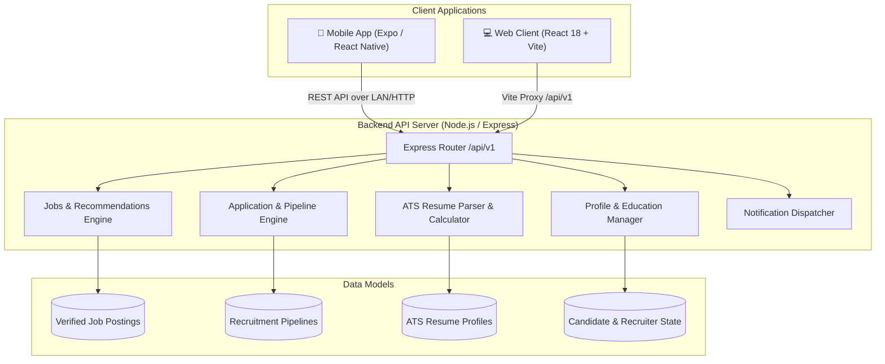
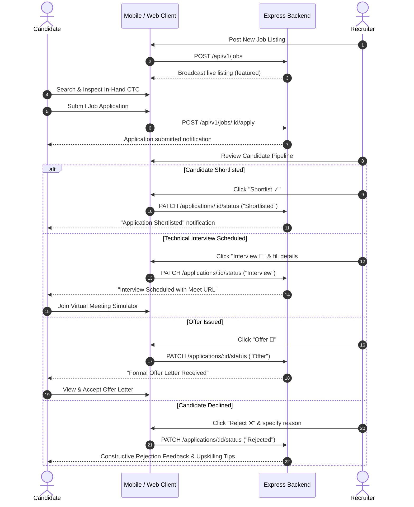

# 🚀 JobFinder Pro — Enterprise Full-Stack Job Portal & Recruitment Suite

[](https://reactnative.dev/)
[](https://expo.dev/)
[](https://react.dev/)
[](https://vitejs.dev/)
[](https://nodejs.org/)
[](https://expressjs.com/)
[](https://opensource.org/licenses/MIT)

**JobFinder Pro** is a modern, enterprise-grade, end-to-end recruitment platform featuring a **React Native cross-platform mobile app (Expo)**, a high-performance **React (Vite) web client**, and an **Express.js RESTful API engine**. 

Designed for both aspiring candidates and enterprise HR teams, it bridges the gap between job discovery, ATS resume evaluation, live virtual interviews, offer letters, and transparent hiring pipelines.

---

## 📑 Table of Contents
- [Architecture & Data Flow](#-system-architecture)
- [Key Features](#-key-features)
  - [👨‍🎓 Candidate Experience](#-candidate-experience)
  - [🏢 Recruiter & HR Suite](#-recruiter--hr-suite)
- [Technology Stack](#-technology-stack)
- [Project Directory Structure](#-project-directory-structure)
- [Installation & Quickstart](#-installation--quickstart)
  - [1. Backend API Server](#1️⃣-backend-api-server)
  - [2. React Web Client](#2️⃣-react-web-client)
  - [3. React Native Mobile App (Expo)](#3️⃣-react-native-mobile-app-expo)
- [REST API Documentation](#-rest-api-documentation)
- [Screen & Component Directory](#-screens--components)
- [End-to-End Recruitment Workflow](#-recruitment-pipeline-workflow)
- [Troubleshooting & FAQs](#-troubleshooting--faqs)
- [License](#-license)

---

## 🏛 System Architecture



---

## ✨ Key Features

### 👨‍🎓 Candidate Experience

1. **🛡️ 100% Authentic & Verified Listings**:
   - Zero spam or fake postings. Curated listings from top tier employers (**Google India, Microsoft, Razorpay, CRED, Swiggy, Zomato, ABC Technologies**).
   - "100% Verified Employer • Direct HR Listing" authenticity badge.
2. **💰 In-Hand CTC Breakdown Calculator**:
   - Transparent compensation breakdown: Fixed Base (75%), Performance Bonus (15%), Employer PF & Statutory Benefits (10%).
   - Accurate estimated monthly take-home salary computation (e.g. `₹85,000 – ₹1,20,000 / month`).
3. **⚡ AI Interview Prep Kit**:
   - Tailored technical questions & answers mapped specifically to each company and role.
   - STAR behavioral interview frameworks and pro-tips for acing engineering rounds.
4. **📹 Interactive Technical Video Interview Simulator**:
   - Recruiter-scheduled virtual rooms with candidate & interviewer stream displays.
   - Real-time mic mute/unmute, camera toggle, live question prompt, and session management.
5. **📄 Official Employment Offer Letter System**:
   - Formal digital offer letters with joining date, reporting manager, annual CTC breakdown, and signing bonus.
   - Accept or Decline offer letters directly in-app.
6. **🤖 ATS Resume Analyzer & Builder**:
   - Real-time ATS keyword matching score (0–100%) against industry standards.
   - Resume deletion automatically syncs with profile completeness score.
7. **👤 Dynamic Profile Completeness**:
   - Accurate, reactive completion percentage based on saved personal details, verified technical skills, education, and uploaded resumes.

---

### 🏢 Recruiter & HR Suite

1. **📢 Job Publishing Portal**:
   - Instant live posting with custom salary brackets, experience tiers, work mode (Remote / Hybrid / On-site), and required skills.
   - Recruiter posts immediately surface at the top of the candidate feed with a `● LIVE NOW` indicator.
2. **👥 Complete 5-Stage Pipeline Management**:
   - **Applied → Shortlisted → Interview → Offer → Rejected**.
3. **📅 Technical Interview Scheduling Modal**:
   - Specify Date, Time slot, Interviewer / Tech Lead name, Google Meet room URL, and technical focus topics.
   - Triggers instant push notifications to the student.
4. **✕ Constructive Candidate Rejection Flow**:
   - Decline candidates with structured reasons (*Skills gap, Experience mismatch, Assessment score*).
   - Deliver actionable upskilling feedback and cooldown advice to help candidates improve.
5. **🎉 One-Click Offer Rolling**:
   - Generate official offer letters with joining timelines and full compensation packages.

---

## 🛠 Technology Stack

### Mobile Client (`/mobile`)
| Package | Version | Purpose |
|---|---|---|
| `react` | 19.1.0 | UI core library |
| `react-native` | 0.86.3 | Native Android & iOS framework |
| `expo` | ~57.0.0 | Managed toolchain & runtime |
| `@expo/vector-icons` | ^15.0.0 | Feather, Ionicons, Material community icons |
| `expo-linear-gradient` | ^15.0.0 | Gradient visual aesthetics |

### Web Client (`/client`)
| Package | Version | Purpose |
|---|---|---|
| `react` | ^18.3.1 | Web frontend library |
| `react-dom` | ^18.3.1 | DOM renderer |
| `vite` | ^5.4.2 | Ultra-fast HMR build tooling |
| `lucide-react` | ^0.468.0 | Modern SVG iconography |
| Vanilla CSS | CSS3 | High-performance custom dark theme |

### Backend REST API (`/server`)
| Package | Version | Purpose |
|---|---|---|
| `express` | ^4.19.2 | RESTful routing & middleware |
| `cors` | ^2.8.5 | Cross-Origin Resource Sharing |
| `dotenv` | ^16.4.5 | Environment variable configuration |
| `node` | >=18.0.0 | Server-side runtime (ES Modules) |

---

## 📁 Project Directory Structure

```text
Job finder/
├── mobile/                           # React Native Expo Mobile App
│   ├── assets/                       # Icons, splash images, fonts
│   ├── src/
│   │   ├── components/               # Reusable UI components
│   │   │   ├── ApplyModal.js         # Application submission sheet
│   │   │   ├── FilterModal.js        # Salary, role & mode filter modal
│   │   │   ├── Header.js             # Top app bar & role switcher
│   │   │   ├── JobCard.js            # Feed job card with save & quick view
│   │   │   ├── JobDetailsModal.js    # In-Hand CTC, AI Prep & Details modal
│   │   │   ├── NotificationsModal.js # Notification center sheet
│   │   │   └── OfferLetterModal.js   # Official formal offer letter modal
│   │   ├── data/
│   │   │   └── initialJobs.js        # Verified authentic jobs dataset
│   │   ├── screens/
│   │   │   ├── AuthScreen.js         # Student / Recruiter sign in & register
│   │   │   ├── HomeScreen.js         # Job feed with category chips & search
│   │   │   ├── ProfileScreen.js      # Profile completeness & experience
│   │   │   ├── RecruiterScreen.js    # HR dashboard, schedule & reject flows
│   │   │   ├── ResumeScreen.js       # ATS resume upload & builder
│   │   │   ├── SavedScreen.js        # Bookmarked jobs
│   │   │   └── TrackerScreen.js      # Video interview simulator & pipeline
│   │   ├── api.js                    # Dynamic LAN/Localhost API bridge
│   │   └── theme.js                  # Dark mode color palette & tokens
│   ├── App.js                        # Root application container & state
│   ├── app.json                      # Expo configuration
│   └── package.json
│
├── client/                           # React Vite Web Client
│   ├── public/                       # Static public assets
│   ├── src/
│   │   ├── components/
│   │   │   ├── ApplicationTracker.jsx# Pipeline tracker with video simulator
│   │   │   ├── ApplyModal.jsx        # Web application modal
│   │   │   ├── AuthScreens.jsx       # Web authentication flow
│   │   │   ├── FilterModal.jsx       # Multi-criteria filter drawer
│   │   │   ├── HomeFeed.jsx          # Desktop job listings feed
│   │   │   ├── JobDetailsModal.jsx   # In-Hand CTC breakdown & AI prep tabs
│   │   │   ├── NotificationsModal.jsx# Web notifications drop-panel
│   │   │   ├── OfferLetterModal.jsx  # Digital offer letter modal
│   │   │   ├── PhoneSimulator.jsx    # Live mobile frame preview
│   │   │   ├── ProfileView.jsx       # User profile & credentials
│   │   │   ├── RecruiterDashboard.jsx# HR candidate review & scheduling
│   │   │   ├── ResumeModule.jsx      # Resume scoring & upload
│   │   │   └── SavedJobs.jsx         # Bookmarked job view
│   │   ├── data/
│   │   │   └── initialJobs.js        # Synced verified job dataset
│   │   ├── App.jsx                   # Web root component
│   │   ├── index.css                 # Custom glassmorphism dark CSS
│   │   └── main.jsx                  # React DOM mount point
│   ├── index.html
│   ├── vite.config.js                # Proxy configuration for /api/v1
│   └── package.json
│
├── server/                           # Express.js REST API Backend
│   ├── server.js                     # Endpoints, in-memory store & controllers
│   ├── .env                          # Server port & config
│   └── package.json
│
└── README.md                         # Project documentation
```

---

## 🚀 Installation & Quickstart

### Prerequisites
- [Node.js (v18 or higher)](https://nodejs.org/)
- `npm` (bundled with Node.js)
- **Expo Go App** installed on your mobile phone:
  - [Download for Android](https://play.google.com/store/apps/details?id=host.exp.exponent)
  - [Download for iOS](https://apps.apple.com/app/expo-go/id982107779)

---

### 1️⃣ Backend API Server

Open a terminal window:
```bash
cd "Job finder/server"
npm install
npm run dev
```
* **Status**: Running at `http://localhost:5000`
* **Health Check**: Visit `http://localhost:5000/api/v1/jobs` in your browser.

---

### 2️⃣ React Web Client

Open a second terminal window:
```bash
cd "Job finder/client"
npm install
npm run dev
```
* **Status**: Running at `http://localhost:3000`
* Requests to `/api/v1/*` are automatically proxied to the backend at port `5000`.

---

### 3️⃣ React Native Mobile App (Expo)

Open a third terminal window:
```bash
cd "Job finder/mobile"
npm install
npx expo start -c
```

#### Connecting via Physical Phone:
1. Ensure your phone and development PC are on the **same Wi-Fi network**.
2. Open `mobile/src/api.js` and verify `BASE_URL` contains your PC's local IP address:
   ```javascript
   // Find your PC's IP using 'ipconfig' (Windows) or 'ifconfig' (Mac/Linux)
   const BASE_URL = 'http://10.134.182.11:5000/api/v1'; 
   ```
3. Open **Expo Go** on your device and scan the terminal QR code.

---

## 📡 REST API Documentation

Base URL: `http://localhost:5000/api/v1`

### 💼 Jobs Endpoints

#### `GET /jobs`
Fetch filtered and searched job listings.
- **Query Parameters**:
  - `q` *(string)*: Search keyword for title, company, or skills.
  - `type` *(string)*: `Full Time` | `Internship` | `Part Time`.
  - `experience` *(string)*: `Fresher` | `0–1 years` | `1–3 years` | `3+ years`.
  - `location` *(string)*: City filter (e.g. `Bangalore`, `Hyderabad`, `Remote`).
  - `workMode` *(string)*: `Remote` | `Hybrid` | `On-site`.
  - `salaryMin` *(number)*: Minimum salary in LPA.
- **Response `200 OK`**:
  ```json
  {
    "success": true,
    "count": 7,
    "jobs": [
      {
        "id": "job-google-01",
        "title": "Software Engineer - Cloud Systems",
        "company": "Google India",
        "salary": "₹22–32 LPA",
        "inHandMonthly": "₹1,45,000 – ₹1,90,000",
        "companyVerified": true,
        "interviewPrep": {
          "proTip": "Master distributed systems and tree/graph traversals.",
          "technicalQuestions": ["..."]
        }
      }
    ]
  }
  ```

#### `POST /jobs`
Publish a new verified job listing (Recruiter).
- **Request Body**:
  ```json
  {
    "title": "Staff Backend Architect",
    "company": "ABC Technologies",
    "location": "Bangalore",
    "workMode": "Hybrid",
    "jobType": "Full Time",
    "salary": "₹24–30 LPA",
    "salaryMin": 24,
    "salaryMax": 30,
    "skills": ["Go", "Kubernetes", "Kafka"],
    "description": "Leading distributed transaction architectures."
  }
  ```

#### `POST /jobs/:id/apply`
Submit candidate job application.
- **Request Body**:
  ```json
  {
    "applicantName": "Aditya Verma",
    "applicantEmail": "aditya.verma@example.com",
    "resumeUsed": "Aditya_Verma_Resume_2026.pdf",
    "coverNote": "Strong background in React & distributed systems."
  }
  ```

---

### 📋 Applications & Pipeline Endpoints

#### `GET /applications`
Retrieve all submitted applications for the current candidate or recruiter.

#### `PATCH /applications/:id/status`
Advance or update a candidate's pipeline status.
- **Request Body (Schedule Interview)**:
  ```json
  {
    "status": "Interview",
    "note": "Technical Round 1 confirmed.",
    "interviewDetails": {
      "date": "Tomorrow",
      "time": "4:00 PM IST",
      "interviewer": "Vikram Sharma (Staff Engineer)",
      "meetUrl": "https://meet.google.com/abc-tech-interview",
      "round": "Technical Round 1",
      "topics": "DSA, Live Coding & System Design"
    }
  }
  ```
- **Request Body (Decline / Reject Candidate)**:
  ```json
  {
    "status": "Rejected",
    "note": "Application reviewed.",
    "rejectionReason": "Skills gap in required technology stack. Please practice React state and reapply after 60 days."
  }
  ```

#### `DELETE /applications/:id`
Withdraw an application.

---

### 📄 Resumes & ATS Scoring

| Method | Endpoint | Description |
|---|---|---|
| `GET` | `/resumes` | Fetch all user resumes |
| `POST` | `/resumes/upload` | Upload PDF and calculate real ATS score |
| `POST` | `/resumes/build` | Generate standardized ATS resume |
| `DELETE` | `/resumes/:id` | Delete resume and recalculate profile completeness |

---

### 👤 Profile & Saved Jobs

| Method | Endpoint | Description |
|---|---|---|
| `GET` | `/profile` | Fetch candidate profile, education, and skills |
| `PUT` | `/profile` | Update profile information |
| `GET` | `/saved-jobs` | Retrieve bookmarked job IDs |
| `POST` | `/saved-jobs/toggle` | Toggle bookmark state for a job |
| `GET` | `/notifications` | Retrieve recruiter alerts & interview invites |
| `POST` | `/notifications/mark-read` | Mark all notifications as read |

---

## 📱 Screens & Components

### Mobile Application Screens

```text
HomeScreen.js
├── Header (Role Toggle & Notifs)
├── Search & Filter Bar
├── Category Pills (Internship, Remote, Fresher, HighPay)
├── Recommended Job Carousels
└── Verified Job Feed List

TrackerScreen.js
├── Pipeline Status Tabs (All, Active, Shortlisted, Interview, Offer, Rejected)
├── Timeline Progress Steps
├── Technical Interview Card -> Opens VideoRoomSimulator Modal
├── Constructive Rejection Card -> Displays Upskilling Advice
└── Offer Letter Action -> Opens OfferLetterModal

RecruiterScreen.js
├── Active Job Postings Counter
├── Candidate Application Review Cards
├── Candidate Action Buttons (Shortlist, Interview, Offer, Reject)
├── PostJobModal (Live publishing)
├── ScheduleInterviewModal (Date, Time, Lead, Meet URL)
└── DeclineCandidateModal (Reason select & custom feedback)

ResumeScreen.js
├── ATS Score Radial Gauge
├── Uploaded Resumes List (Download & Delete actions)
└── Quick ATS Resume Builder Form

ProfileScreen.js
├── Profile Completeness Bar (0-100% dynamic calculation)
├── Personal Details (Email, Phone, Location, Batch)
├── Technical Skills Badges
└── Education & Work Experience Cards
```

---

## 🔄 Recruitment Pipeline Workflow



---

## ❓ Troubleshooting & FAQs

### 1. Expo: "Network response timed out" or "Could not connect to Metro"
* Ensure your PC and phone are connected to the exact same Wi-Fi network.
* Verify Windows Defender Firewall allows Node.js incoming traffic on port `8081` and `5000`.
* Restart Metro bundler with cache cleared:
  ```bash
  npx expo start -c
  ```

### 2. Mobile App: "API Error: Network request failed"
* When testing on a physical phone, `localhost` points to the phone itself, not your PC.
* Update `BASE_URL` in `mobile/src/api.js` to match your PC's IP address:
  ```bash
  # Windows
  ipconfig
  # macOS / Linux
  ifconfig
  ```
  Look for `IPv4 Address` (e.g. `192.168.1.15` or `10.134.182.11`) and set:
  ```javascript
  const BASE_URL = 'http://192.168.1.15:5000/api/v1';
  ```

### 3. Web Client: "Proxy error / ECONNREFUSED"
* Verify that the backend server is running in a separate terminal:
  ```bash
  cd server && npm run dev
  ```
  It must be accessible at `http://localhost:5000`.

---

## 📄 License

This project is licensed under the **MIT License** — you are free to modify, distribute, and use it for commercial and personal projects.

---

<p align="center">
  Built with ❤️ for modern engineering teams and ambitious candidates.
</p>
